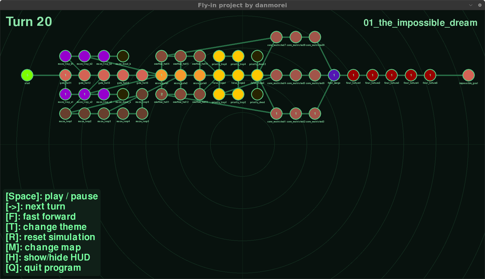
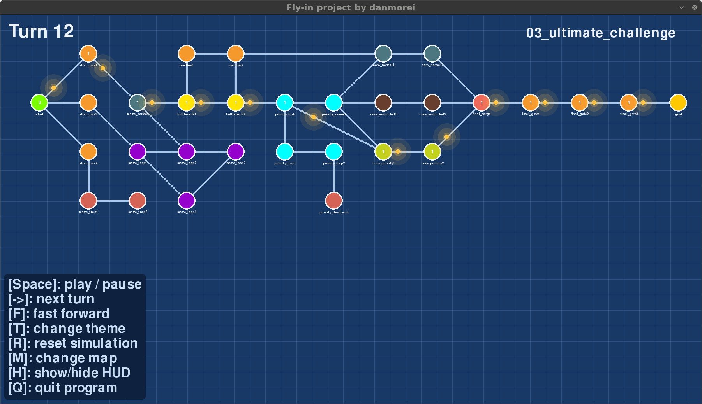

*This project has been created as part of the 42 curriculum by danmorei.*

# Fly-in

> Route a fleet of drones from a start zone to an end zone through a network of connected zones, in as few simulation turns as possible, while respecting zone and link capacities.

 

---

## Description

Fly-in reads a map file describing a graph of **zones** (hubs) and **connections**, then simulates every drone moving turn by turn from `start_hub` to `end_hub`.

The goal of the project is not finding a path but moving many drones at once without breaking any rule:
- a zone holds `max_drones` drones (default 1), except start and end
- a connection carries `max_link_capacity` drones at a time (default 1)
- moving into a **restricted** zone takes 2 turns
- **blocked** zones can never be entered

The program prints one line per turn (`D1-roof1 D2-corridorA`) and can also show the whole simulation in an animated pygame window.

---

## Instructions

### Requirements

- Python **3.10+**
- [uv](https://docs.astral.sh/uv/) (dependency and virtual-environment manager)

### Install

```bash
make install        # uv sync: creates .venv and installs pygame-ce, flake8, mypy
```

### Run

```bash
make run                                   # default map
make run MAP=maps/hard/03_ultimate_challenge.txt
uv run python main.py <map_file>           # text output
uv run python main.py <map_file> --visual  # pygame viewer
```

### Other Makefile rules

| Rule | Does |
|---|---|
| `make debug` | runs the program under `pdb` |
| `make lint` | `flake8 .` + `mypy` with the subject's flags |
| `make lint-strict` | `flake8 .` + `mypy --strict` |
| `make clean` | removes `__pycache__`, `.mypy_cache`, etc. |
| `make fclean` | removes `__pycache__`, `.mypy_cache`, `virtual-environment` |


---

## Map format

```
nb_drones: 5

start_hub: hub 0 0 [color=green]
end_hub: goal 10 10 [color=yellow]
hub: roof1 3 4 [zone=restricted color=red]
hub: corridorA 4 3 [zone=priority max_drones=2]

connection: hub-roof1
connection: corridorA-tunnelB [max_link_capacity=2]
```

- `zone=` one of `normal` (default), `blocked`, `restricted`, `priority`
- `color=` any single word (unknown colours fall back to a default)
- lines starting with `#` are comments

---

## Algorithm choices and implementation strategy

### 1. The objective

On a single path of length `L` with `n` drones and capacity 1, the drones move like a pipeline:
the first arrives after `L` turns, then one more every turn.

Adding a longer path only helps when it lowers that maximum, so "more paths" is not automatically better. The real limit is the **narrowest point** of the map (e.g. a zone with `max_drones=1` that every route crosses).

### 2. Distance map: reverse Dijkstra (`PathFinder`)

Instead of storing a fixed path per drone, the program computes **one number per zone**: how many turns a drone needs to reach the end from there.

- Dijkstra runs **backwards from the end zone**
- the cost of a move is the cost of the zone being **entered** (`normal`/`priority` = 1, `restricted` = 2), so a backward step from X to Y is charged X's cost
- `blocked` zones are never expanded
- zones that cannot reach the end are simply absent from the result; if the **start** is absent, the map is rejected before any simulation runs

Paths are never stored: a drone always moves "downhill" on this distance map, which works from any zone at any time.

### 3. Turn scheduler (`Simulation`)

Each turn:

1. **Order**: drones are sorted by *turns left to the end* (closest first), ties broken by drone id.
   Front drones move first, so the space they free is usable by the drones behind them **in the same turn**.
2. **Landing**: drones in flight toward a restricted zone land (that is their move for the turn).
3. **Decision** for every drone standing in a zone:
   - rank neighbours by `cost + distance`
   - take the first one with room in the zone and on the link
   - if the best one is full, compare **waiting** (`1 + best`) with the best **detour** that has room; a detour is taken only if strictly cheaper
4. **Restricted moves**: the drone steps onto the connection and **reserves** a slot in the destination, so the landing next turn is guaranteed.
5. **Delivery**: drones in the end zone are removed; the simulation stops when none are left.

**Occupancy:** counts are rebuilt at the start of each turn from the drones' states (present + reserved per zone, in-flight per link), then updated as drones move. A self-check at the end of every turn verifies no zone or link exceeds its capacity.

### 4. Complexity

- `PathFinder`: Dijkstra with a binary heap
- one simulation turn: sorting drones **O(D log D)** + each drone looks at its neighbours **O(D · deg)**
- memory: one distance per zone, one state per drone

---

## Benchmarks

| Map | Target | Result |
|---|---|---|
| easy 1 / 2 / 3 | ≤ 6 / 8 / 6 | 4 / 4 / 4 |
| medium 1 / 2 / 3 | ≤ 12 / 15 / 12 | 6 / 15 / 8 |
| hard 1 / 2 / 3 | ≤ 30 / 35 / 45 | 13 / 16 / 26 |
| challenger | record 45 | 45 |

---

## Visual representation

### Terminal (default)

- each zone name in the output is coloured with the zone's `color` from the map (24-bit terminal colours)
- `color=rainbow` colours each letter differently
- unknown colours fall back to plain text, so any map still works

### Pygame viewer (`--visual`)

- zones drawn at their map coordinates, scaled to the window; connections as lines
- drones **glide** between zones; a drone flying to a restricted zone stops halfway along the link for one turn
- parked drones are shown as a **count in the centre** of their zone
- zones **bump** briefly when a drone arrives or leaves
- several **themes** with their own background texture (grid, dots, scanlines, radar rings, code columns)

### Controls

| Key | Action |
|---|---|
| `Space` | play / pause |
| `→` | next turn (while paused) |
| `F` | change speed (×1 / ×2 / ×4) |
| `T` | next theme |
| `M` | next map in `maps/` |
| `R` | reset the current map |
| `H` | show / hide the controls |
| `Q` | quit |

---

## Project structure

| File | Contents |
|---|---|
| `main.py` | entry point, argument parsing, text-mode loop |
| `parsing.py` | `MapParser`: reads and validates the map file |
| `models.py` | `Zone`, `ZoneType`, `ZoneRole`, `Connection`, `Map` |
| `pathfinder.py` | `PathFinder`: reverse Dijkstra distance map |
| `simulation.py` | `Simulation`: turn scheduler, capacities, self-check |
| `drone.py` | `Drone`, `DroneState`, `Move`, `ZoneMove`, `ConnectionMove` |
| `output.py` | `TextPrinter`, `ColorPrinter` |
| `colors.py` | colour table, `Theme`, `Texture`, themes |
| `visual.py` | `Visualizer`: pygame-ce viewer |
| `errors.py` | `FlyInError` |

---

## Design decisions

- Comments are **whole-line only** (`#` is a legal character in zone names).
- A connection from a zone to itself is rejected.
- `max_drones` on start / end zones is ignored.
- Duplicate connections are detected with an order-independent key (`a-b` = `b-a`).
- In-flight drones are printed as `D<id>-<zoneA>-<zoneB>`.
- Errors in the map stop the program with `Error line N: <cause>` on stderr.

---

## Resources

- Dijkstra's algorithm: [Wikipedia](https://en.wikipedia.org/wiki/Dijkstra%27s_algorithm)
- Max-flow / Edmonds–Karp (studied during design, not used in the final version): [Wikipedia](https://en.wikipedia.org/wiki/Edmonds%E2%80%93Karp_algorithm)
- Python `heapq`: [docs.python.org](https://docs.python.org/3/library/heapq.html)
- `argparse` tutorial: [docs.python.org](https://docs.python.org/3/howto/argparse.html)
- `match` statement, PEP 636: [peps.python.org](https://peps.python.org/pep-0636/)
- pygame-ce documentation: [pyga.me/docs](https://pyga.me/docs/)
- ANSI escape codes: [Wikipedia](https://en.wikipedia.org/wiki/ANSI_escape_code)

### How AI was used

Claude by Anthropic was used in this project for the following:

- **Design phase:** Discuss the problem (throughput vs. path length, capacities, max-flow vs. a distance-map approach). The final design choices were made by me.
- **Implementation:** Explained concepts (heaps, lambdas, dataclasses, pygame's game loop, interpolation).

AI was NOT used to write or generate any code.
